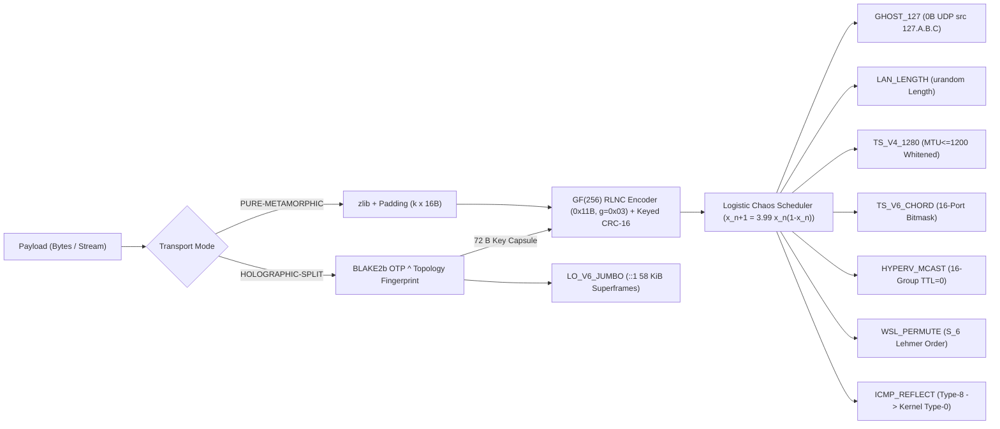

# CHIMERA-TP

**Cross-Host Interface Metamorphic Entangled Routing Architecture — Transport Protocol**

CHIMERA-TP là một giao thức truyền tải thực nghiệm bằng Python 3.11 thuần (không phụ thuộc thư viện ngoài), được thiết kế để khai thác đồng thời toàn bộ các lớp giao diện mạng và "dị tật" (quirks) của hệ điều hành Windows hiện đại thành 8 kênh truyền dị biệt, kết hợp mã hóa phun tuyến tính ngẫu nhiên trên trường hữu hạn $GF(2^8)$ (RLNC) và bản đồ hỗn loạn Logistic.

> **Phạm vi nghiên cứu**: Toàn bộ 8 kênh hiện hoạt động khép kín trên các giao diện nội bộ của cùng một máy chủ (`127.0.0.0/8`, `::1`, địa chỉ cục bộ của NIC Ethernet, Tailscale tunnel, Hyper-V vSwitch, WSL2 vSwitch) để nghiên cứu kỹ thuật giao thức, mã hóa kênh phụ (covert/side-channel transport) và chịu lỗi đa đường truyền mà không phát gói nhiễu ra Internet.

---

## Kiến trúc tổng quan



### 8 Cõi truyền tải (Transport Realms)

| Lane ID | Giao diện đích (Ví dụ Windows) | Cơ chế điều chế tín hiệu |
| :--- | :--- | :--- |
| `GHOST_127` | Loopback `127.0.0.0/8` | Gói UDP **0 byte payload**, giấu 2 byte + tag vào IP nguồn `127.A.B.C` |
| `LAN_LENGTH` | Ethernet LAN IPv4 | Chỉ gửi `os.urandom(...)`, giải mã thuần theo độ dài gói (`64..1343 B`) |
| `TS_V4_1280` | Tailscale Tunnel IPv4 (MTU 1280) | Khung làm trắng bằng BLAKE2b ép chuẩn `<= 1200 B` |
| `TS_V6_CHORD` | Tailscale ULA IPv6 | Hợp âm 16 cổng note IPv6 + 1 cổng barline chốt bitmask từ 16-bit |
| `HYPERV_MCAST` | Hyper-V Default Switch | 16 nhóm multicast `239.255.13.1..16` (`IP_MULTICAST_TTL=0`) đại diện nibble |
| `WSL_PERMUTE` | WSL2 vEthernet | Mã hóa từng byte theo thứ tự đến của 6 gói hoán vị ($S_6$ Lehmer rank) |
| `ICMP_REFLECT` | Raw ICMP `127.0.0.1` (Admin) | Gửi Echo Request (Type 8), thu bản phản xạ kernel Echo Reply (Type 0) |
| `LO_V6_JUMBO` | Loopback `::1` (MTU 4 GiB) | Bơm siêu khung 58 KiB đã che khóa OTP theo `topology_fingerprint` |

---

## Cài đặt & Chạy nhanh

Yêu cầu: **Windows 10/11**, **Python >= 3.11** (chạy với quyền Administrator nếu muốn bật thêm kênh raw socket `ICMP_REFLECT`; ở quyền user thường giao thức tự động bỏ qua `ICMP_REFLECT` và chạy bình thường trên 7 kênh còn lại).

```powershell
# Tùy chọn: cài editable để dùng lệnh `chimera-tp` toàn cục
pip install -e . --no-build-isolation

# 1. Tự động dò 8 cõi mạng trên máy hiện tại
python -m chimera_tp probe

# 2. Chạy demo 4 pha (Pure-Metamorphic, Apocalypse Chaos Survival, Holographic 256 KiB)
python -m chimera_tp demo

# 3. Gửi thông điệp có tiêm lỗi giả lập (tắt 2 làn + 20% mất gói + đảo 100% bit payload LAN)
python -m chimera_tp send --text "Xin chao CHIMERA-TP" --mode metamorphic --kill GHOST_127,WSL_PERMUTE --drop 0.2 --corrupt-lan

# 4. Chạy bộ test đơn vị & tích hợp (7/7 tests)
python -m unittest discover -s tests -v

# 5. Chạy đầy đủ 6 suite benchmark & đánh giá Before-vs-After
python -m benchmarks.benchmark_eval
```

---

## Tóm tắt kết quả Benchmark (v0.2.0)

Số liệu thực nghiệm đo trên hệ thống Windows 11/10 thực tế (`7/7` unit tests PASS, `20/20` soak test PASS):

| Kịch bản | Baseline (TCP/UDP chuẩn) | CHIMERA-TP | Nhận xét kỹ thuật |
| :--- | :--- | :--- | :--- |
| **512 B bình thường** | TCP `21.60 ms` (`189.6 kbps`)<br/>UDP `0.39 ms` (`10.5 Mbps`) | `35.31 ms` (`116.0 kbps`)<br/>`55.76x` wire amplification | Đánh đổi băng thông lấy phân mảnh trên 7 giao diện |
| **1 MiB Bulk (`::1`)** | TCP `21.78 ms` (`385.1 Mbps`)<br/>Wire entropy `6.123 b/B` | `99.27 ms` (`84.50 Mbps`)<br/>Wire entropy **`7.99982 b/B`** | Khối bulk che OTP gắn `topology_fingerprint` |
| **4 MiB Bulk (`::1`)** | — | `367.25 ms` (**`91.37 Mbps`**)<br/>Wire entropy **`7.99995 b/B`** | 73 siêu khung 58 KiB + capsule 72 B |
| **20% mất gói (512 B)** | UDP **FAIL** (`464/512 B`) | **PASS** (`54.10 ms`, `12->11` giọt) | GF(256) tự bù gói mất không cần ARQ |
| **Đảo 100% bit payload** | UDP **FAIL** (sai SHA-256) | **PASS** (`10.75 ms`, `LAN_LENGTH`) | Miễn nhiễm hoàn toàn với sửa nội dung gói |
| **Đứt 3 card/tunnel** | Single-NIC **FAIL** (`0%`) | **PASS** (`17.53 ms`, còn 4 làn) | Tự chuyển tải sang các làn sống sót |
| **Sweep mất gói 0→70%** | — | **6/6 PASS** (`460.01 ms` @ `70%`) | Tỷ lệ phát dư `3.45x` ở ngưỡng 70% drop |

Chi tiết kỹ thuật xem tại:
- [docs/ARCHITECTURE.md](docs/ARCHITECTURE.md) — Đặc tả toán học GF(256), cấu trúc khung dây và trạng thái từng kênh.
- [docs/EVALUATION.md](docs/EVALUATION.md) — Phân tích Before-vs-After, giới hạn băng thông/$O(K^3)$, và hậu kiểm 2 bug được phát hiện khi stress test.
- [docs/ROADMAP.md](docs/ROADMAP.md) — Lộ trình nghiên cứu tiếp theo.

---

## Cấu trúc thư mục

```text
chimera-tp/
├── chimera_tp/          # Gói giao thức lõi (probe, gf256, lanes, protocol, cli, demo)
├── tests/               # Unit & integration tests (unittest)
├── benchmarks/          # Harness benchmark 6 suite (Before-vs-After, Solo, Sweep, Scaling, Soak, Audit)
├── examples/            # Script chạy nhanh demo 4 pha
├── docs/                # Tài liệu đặc tả kiến trúc, đánh giá thực nghiệm và lộ trình
└── pyproject.toml       # Metadata & entrypoint CLI `chimera-tp`
```

## Giấy phép

Phát hành theo giấy phép [MIT](LICENSE).
