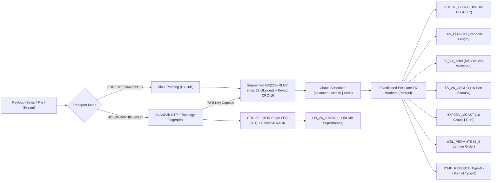

# CHIMERA-TP (v0.5.0)

**Cross-Host Interface Metamorphic Entangled Routing Architecture — Transport Protocol**

CHIMERA-TP là một giao thức truyền tải thực nghiệm bằng Python 3.11 thuần (không phụ thuộc thư viện ngoài), được thiết kế để khai thác đồng thời toàn bộ các lớp giao diện mạng và "dị tật" (quirks) của hệ điều hành Windows hiện đại thành 8 kênh truyền dị biệt, kết hợp **Segmented GF(256) RLNC**, lập lịch hỗn loạn song song đa luồng (`balanced` / `stealth` / `turbo`), và **XOR Stripe FEC + Selective NACK ARQ**.

> **Phạm vi nghiên cứu**: Toàn bộ 8 kênh hiện hoạt động khép kín trên các giao diện nội bộ của cùng một máy chủ (`127.0.0.0/8`, `::1`, địa chỉ cục bộ của NIC Ethernet, Tailscale tunnel, Hyper-V vSwitch, WSL2 vSwitch) để nghiên cứu kỹ thuật giao thức, mã hóa kênh phụ (covert/side-channel transport) và chịu lỗi đa đường truyền mà không phát gói nhiễu ra Internet.

---

## Kiến trúc tổng quan (v0.5.0)



### 8 Cõi truyền tải (Transport Realms)

| Lane ID | Giao diện đích (Windows) | Cơ chế điều chế tín hiệu |
| :--- | :--- | :--- |
| `GHOST_127` | Loopback `127.0.0.0/8` | Gói UDP **0 byte payload**, giấu 2 byte + tag vào IP nguồn `127.A.B.C` |
| `LAN_LENGTH` | Ethernet LAN IPv4 | Chỉ gửi `os.urandom(...)`, giải mã thuần theo độ dài gói (`64..1343 B`) |
| `TS_V4_1280` | Tailscale Tunnel IPv4 (MTU 1280) | Khung làm trắng bằng BLAKE2b ép chuẩn `<= 1200 B` |
| `TS_V6_CHORD` | Tailscale ULA IPv6 | Hợp âm 16 cổng note IPv6 + 1 cổng barline chốt bitmask từ 16-bit |
| `HYPERV_MCAST` | Hyper-V Default Switch | 16 nhóm multicast `239.255.13.1..16` (`IP_MULTICAST_TTL=0`) đại diện nibble |
| `WSL_PERMUTE` | WSL2 vEthernet | Mã hóa từng byte theo thứ tự đến của 6 gói hoán vị ($S_6$ Lehmer rank) |
| `ICMP_REFLECT` | Raw ICMP `127.0.0.1` (Admin) | Gửi Echo Request (Type 8), thu bản phản xạ kernel Echo Reply (Type 0) |
| `LO_V6_JUMBO` | Loopback `::1` (MTU 4 GiB) | Siêu khung 58 KiB che OTP + CRC-32 + XOR Stripe FEC (4:1) + Selective NACK |

---

## Cài đặt & Chạy nhanh

Yêu cầu: **Windows 10/11**, **Python >= 3.11** (chạy với quyền Administrator nếu muốn bật thêm kênh raw socket `ICMP_REFLECT`; ở quyền user thường giao thức tự động bỏ qua `ICMP_REFLECT` và chạy bình thường trên 7 kênh còn lại).

```powershell
# Tùy chọn: cài editable để dùng lệnh `chimera-tp` toàn cục
pip install -e . --no-build-isolation

# 1. Dò 8 cõi mạng trên máy hiện tại
python -m chimera_tp probe

# 2. Chạy demo 4 pha
python -m chimera_tp demo

# 3. Chế độ 2 tiến trình độc lập (Terminal 1: listen, Terminal 2: connect)
python -m chimera_tp listen --offer-file .\offer.json --out-file .\received.bin
python -m chimera_tp connect --offer-file .\offer.json --file .\payload.bin --mode holographic --jumbo-drop 0.25

# 4. Gửi 1 tiến trình với profile turbo/stealth/balanced
python -m chimera_tp send --text "Xin chao CHIMERA-TP v0.5" --mode metamorphic --profile turbo --drop 0.2 --corrupt-lan

# 5. Chạy bộ test đơn vị & tích hợp (11/11 tests)
python -m unittest discover -s tests -v

# 6. Chạy đầy đủ benchmark đánh giá v0.5.0
python -m benchmarks.benchmark_eval
```

---

## Tóm tắt kết quả nâng cấp v0.2.0 &rarr; v0.5.0

Số liệu thực nghiệm đo trên máy Windows thực tế (`11/11` unit tests PASS, `20/20` soak test PASS, `5/5` audit PASS):

| Chỉ số | v0.2.0 | v0.5.0 | Cải thiện |
| :--- | :--- | :--- | :--- |
| **2 KiB không nén (`PURE-METAMORPHIC`)** | `363.42 ms` (`45.08 kbps`, `204.0x`) | `83.71 ms` (`balanced`), **`65.32 ms`** (`turbo`, `250.8 kbps`, `78.9x`) | **Nhanh hơn 4.34x – 5.56x**, giảm dây 2.58x |
| **4 KiB không nén (`PURE-METAMORPHIC`)** | `765.70 ms` (`42.79 kbps`) | **`180.69 ms`** (`181.35 kbps`) | **Nhanh hơn 4.24x** |
| **16 KiB không nén (`PURE-METAMORPHIC`)** | Nghẽn $O(K^3)$ | **`536.78 ms`** (**`244.18 kbps`**, 33 generations) | Mở rộng quy mô tuyến tính $O(K)$ |
| **20-Run Soak Test (p50 / p95)** | `53.20 ms` / `214.78 ms` | **`24.35 ms`** / **`129.10 ms`** | **Giảm 2.18x độ trễ trung vị** |
| **`HOLOGRAPHIC-SPLIT` mất 25% chunk (`1 MiB`)** | Không phục hồi | **`111.55 ms`** (**`75.20 Mbps`**, `FEC=4, NACK=2`) | **Sống sót 100%** dưới 25% rớt jumbo |
| **`HOLOGRAPHIC-SPLIT` `8 MiB`** | Chưa kiểm thử | **`787.55 ms`** (**`85.21 Mbps`**, entropy `7.99998 b/B`) | Bơm 145 siêu khung 58 KiB an toàn |

Chi tiết kỹ thuật xem tại:
- [docs/ARCHITECTURE.md](docs/ARCHITECTURE.md) — Đặc tả Segmented GF(256) RLNC, 8 kênh, Parallel TX Worker, Stripe XOR FEC & Selective NACK.
- [docs/EVALUATION.md](docs/EVALUATION.md) — Phân tích Before-vs-After (TCP/UDP chuẩn vs CHIMERA-TP), so sánh v0.2.0 vs v0.5.0, và giới hạn còn lại.
- [docs/ROADMAP.md](docs/ROADMAP.md) — Lộ trình nghiên cứu tiếp theo.

---

## Giấy phép

Phát hành theo giấy phép [MIT](LICENSE).
