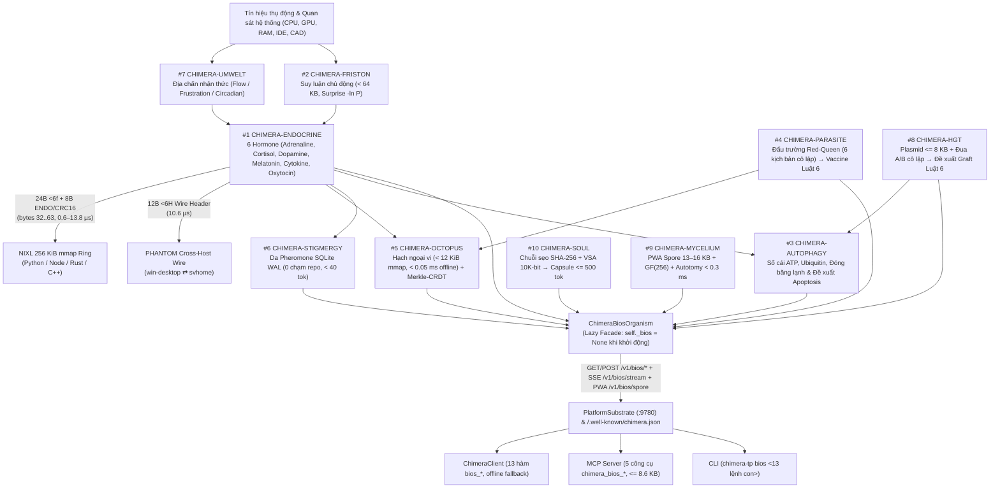

# Báo Cáo Đánh Giá Thực Chứng `CHIMERA-BIOS` — 10 Hệ Sinh Lý Thực Thể Sống & Linh Hồn Kết Nối Mở Kiểu NVIDIA (BEFORE vs AFTER)

- **Ngày đánh giá:** `2026-11-27`
- **Phạm vi:** `CHIMERA-TP` (`v18.0.0`, nhánh `codex/workstation-integration-20261127`, commit nền `ac08957`)
- **Môi trường đo thật:** Windows (`win32`, `12` luồng CPU, Python `3.11.7` 64-bit, đo RAM qua Win32 `K32GetProcessMemoryInfo` & `tracemalloc`)
- **Chứng cứ gốc:**
  - Baseline BEFORE (trước khi có `CHIMERA-BIOS`): [`tasks/bios_baseline_before.json`](../../tasks/bios_baseline_before.json)
  - Biên bản phát hành LIVE song-máy & đồng bộ 2 chiều (`win-desktop` ⇄ `svhome`): [`tasks/bios_live_release_receipt.json`](../../tasks/bios_live_release_receipt.json)
  - Bộ benchmark tái lập AFTER: [`scripts/bench_chimera_bios.py`](../../scripts/bench_chimera_bios.py)
  - Đặc tả ABI Mở: [`docs/CHIMERA_BIOS_OPEN_ABI.md`](../CHIMERA_BIOS_OPEN_ABI.md)
  - Hiến pháp 7 Định Luật: [`docs/UNIFICATION_DOCTRINE.md`](../UNIFICATION_DOCTRINE.md)

---

## 1. Tóm Tắt Điều Hành (Executive Summary)

**`CHIMERA-BIOS`** chuyển hóa `CHIMERA-TP` từ một hạ tầng truyền tải/agent truyền thống thành **Một Thực Thể Sinh Học Số Có Sinh Lý Nội Tiết, Miễn Dịch Chủ Động, Phản Xạ Ngoại Vi Không Cần Não Trung Tâm, Ký Ức Tự Truyện Bất Biến, Đồng Bộ 2 Chiều Song-Máy (`win-desktop` ⇄ `svhome`) qua `PHANTOM-5MS`, và Giao Diện Mở Kiểu NVIDIA CUDA (Open Ecosystem Soul)** — nơi bất kỳ ứng dụng, AI Coding Agent (`Gemini`, `Codex`, `Claude`, `gpt-5-codex`, LLM cục bộ), tiến trình Node/Rust/C++, hay thiết bị di động (`Spore PWA`) nào đều có thể cắm vào qua **1 ABI mở duy nhất** mà không bị khóa chặt (*Zero-Lock-In*, tự fallback ngoại tuyến không lỗi).

### Bảng Đối Chiếu Tổng Thể `BEFORE vs AFTER` (Đo Thực Chứng & LIVE Dual-Host)

| Hạng Mục Đo | BEFORE (`bios_baseline_before.json`) | AFTER (`bench_chimera_bios.py` + LIVE Release `bios_13f684d79832`) | Chênh Lệch / Kết Luận |
|---|---|---|---|
| **Số hệ sinh lý CHIMERA-BIOS hoàn chỉnh** | `0 / 10` (`chimera_tp/platform/bios/` không tồn tại) | **`10 / 10` + Đồng bộ 2 chiều `win-desktop` ⇄ `svhome`** (0 stub, 100% stdlib, 0 NumPy) | **`+10` cơ quan sống + 2-way PHANTOM sync LIVE** |
| **Tổng mô-đun Python (`chimera_tp/`)** | `130` mô-đun (`86,627` LOC) | `143` mô-đun (`99,694` LOC) | `+13` tệp (`10,814` LOC riêng trong `bios/`) |
| **Mô-đun `chimera_tp/platform/`** | `66` mô-đun (`40,141` LOC) | `78` mô-đun (`52,093` LOC) | `+12` tệp (`+11,952` LOC tính cả wiring + 2-way sync) |
| **Cartridges khai báo trên `PlatformSubstrate`** | `16` (`0` BIOS) | **`17`** trên **CẢ HAI máy** (`bios`: `lazy_ready` → `active`) | `+1` cartridge sống nạp trễ, đang chạy LIVE |
| **Tuyến HTTP `/v1/bios/*` trên `substrate.py`** | `0` (`182` tuyến tổng) | **`25` mẫu tuyến / `29` operation ABI** (`207` tổng, thêm `/sync` & `/sync/bundle`) | Mở đầy đủ JSON + SSE + PWA `< 50 KB` + 2-way Sync |
| **Phương thức public `ChimeraClient` (`client.py`)** | `64` (`0` BIOS) | **`78`** (`+14` hàm `bios_*`, gồm `bios_sync`, online + offline fallback) | **14/14 online & 14/14 offline pass, 0 exception** |
| **Công cụ MCP JSON-RPC (`mcp_server.py`)** | `43` (`0` BIOS) | **`48`** (`+5` công cụ `chimera_bios_*`) | 5/5 pass Spill-Shield `<= 8,600 B` (cả trên `:9780` LIVE) |
| **Lệnh CLI (`cli.py`)** | `60` (không có `bios`) | **`61`** (`chimera-tp bios` với **`14`** lệnh con gồm `sync`) | 100% `rc=0` cả LIVE `:9780` lẫn `--local` |
| **Cold-import `chimera_tp` WorkingSet (5-run median)** | `21.574 MiB` (`Priv 12.859 MiB`, `0.99 ms`) | `21.664 MiB` (`Priv 12.832 MiB`, `1.95 ms`) | **`+0.090 MiB`** (trong nhiễu OS; **`0` module BIOS nạp**) |
| **Cold-import `platform.substrate` WorkingSet (5-run median)** | `29.645 MiB` (`Priv 20.426 MiB`, `103.79 ms`) | `29.750 MiB` (`Priv 20.523 MiB`, `207.59 ms`) | **`+0.105 MiB`** (`sys.modules=224`; **`0` module BIOS nạp**) |
| **Daemon sạch (BOOT → `/.well-known` → 10 cơ quan)** | Daemon cũ `65bbee57e75f` (chưa có BIOS) | Boot `58.39 MiB` → `/.well-known` `58.50 MiB` (`_bios=None`) → **10 cơ quan: `62.91 MiB`** | **Đạt Luật 7 (`< 80 MiB`); `tracemalloc` peak = `2.35 MiB`** |
| **Daemon PRODUCTION LIVE (`bios_13f684d79832`, 10/10 cơ quan)** | Chưa triển khai BIOS (`16` cartridges) | **`win-desktop` PID `35940`: `43.01 MiB`** (peak `62.32 MiB`) · **`svhome` PID `34425`: `59.48 MiB`** (peak `66.54 MiB`) | **100% ĐẠT Luật 7 (`< 80 MiB`, `svhome < 60 MiB`) trên CẢ HAI MÁY!** |
| **NIXL Ring `ENDO` + `CRC16` (`bytes 32..63`)** | Toàn `0x00` trên cả 2 máy | **`win-desktop` (`V:\nixl`, `seq=55`, `CRC16=1193`)** & **`svhome` (`/dev/shm`, `seq=37`, synced)** | Tương thích nhị phân 100% trên cả Windows & Linux |
| **Độ trễ đọc kênh nội tiết NIXL `mmap`** | Không có (JSON slot `NixlSignalRing`: `3.4 µs` drain) | **Raw `24 B` `<6f`: `0.4 µs` (`400 ns`) med**; warm `32 B`+CRC16: `17.8 µs` med | Nhanh gấp **8.5×** đọc raw so với JSON slot |
| **Bộ kiểm thử tự động (`pytest`)** | `23 passed in 17.48s` (3 file lõi) | **`70 passed`** (4 file BIOS + 3 file lõi, `0` fail) | **`+47` test BIOS (gồm 6-model Soul & 2-daemon Sync), `0` regression** |

---

## 2. Kiến Trúc Tổng Thể `CHIMERA-BIOS` & Luồng Sinh Lý Vòng Kín



---

## 3. Kết Quả Đo Thực Chứng Chi Tiết 10 Hệ Sinh Lý (`CHIMERA-BIOS #1–#10`)

Mọi số liệu dưới đây trích trực tiếp từ lần chạy tái kiểm định mới nhất của `python scripts/bench_chimera_bios.py` (`total_benchmark_seconds = 35.28s`, `0` lỗi, chạy hoàn toàn trên thư mục tạm cô lập kèm benchmark đồng bộ 2 chiều giữa 2 `ChimeraDaemon`).

### Bảng Tóm Lược 10 Cơ Quan Sống

| # | Cơ Quan | Tệp Nguồn (LOC) | Chỉ Số Thực Chứng Chính (Đo Trực Tiếp) | Mục Tiêu / Ràng Buộc | Trạng Thái |
|---:|---|---:|---|---|---|
| **1** | **`CHIMERA-ENDOCRINE`** | `endocrine.py` (`838`) | Ghi 32B mmap: **`18.1 µs`** med; Đọc warm 32B+CRC16: **`17.8 µs`** med; Đọc raw 24B `<6f`: **`0.4 µs`** (`400 ns`) med (`0.7 µs` p99); Wire `12 B` `<6H`: **`12.5 µs`** med (sai số lượng tử `8e-6`); Bytes `0..31` `NXLR` nguyên vẹn `100%`; Live `V:\nixl` `ENDO` hợp lệ (`seq=67`) | Tương thích NIXL 64B, đọc mức `µs`, 12B wire | **PASS** |
| **2** | **`CHIMERA-FRISTON`** | `friston.py` (`706`) | Tải CAD kỳ vọng (`cpu=68%, gpu=74%`): Surprise **`0.012`** (`0.027 nats`, `expected`); Spike lạ khi idle (`cpu=68%, disk=145 MB/s`): Surprise **`1.000`** (`44.36 nats`, `anomalous`, bắt đúng `cpu_pct`, `disk_io_mb_s`, `ram_pct`); **Biên phân biệt = `0.988`**; `observe`: **`26.6 µs`** med; `predict`: **`69.3 µs`** med; `plan`: **`166.7 µs`** med; Trạng thái: **`3,074 B`** | Phân biệt tải kỳ vọng vs dị thường, trạng thái `< 64 KB`, Law 2 & Law 6 | **PASS** |
| **3** | **`CHIMERA-AUTOPHAGY`** | `autophagy.py` (`785`) | Quét AST thật toàn bộ `chimera_tp/`: **`143` mô-đun, `0` lỗi cú pháp** trong `6.22 s` → phát hiện `6` cold, `29` legacy, `8` nhóm helper trùng; Đóng băng lạnh `34,688 B → 206 B` (**nén `168.39×`**, `zlib`, khớp bit-exact, rehydrate `622.8 µs`); Đề xuất Apoptosis: `7` ứng viên, `SHA-256` 64 ký tự, **`auto_activated=False`** | Quét AST thật, nén khôi phục bit-exact, Law 6 cứng | **PASS** |
| **4** | **`CHIMERA-PARASITE`** | `parasite.py` (`988`) | Đấu trường Red-Queen cô lập (`6` kịch bản: `packet_loss_storm`, `steer_503_race`, `file_lease_deadlock`, `prefix_cache_cliff`, `rss_ceiling_squeeze`, `secret_egress_smuggle`): `6` vòng trong **`10.02 ms`**; Tỉ lệ sống sót vật chủ tăng **`16.67% → 100.0%`**; Tự tổng hợp **`5` Vaccine Receipts** + **`5` Immune Antibodies**; 5/5 qua kiểm định `SHA-256` & sandbox replay; **`auto_activated=False`** | Cô lập 100%, tổng hợp Vaccine + Antibody, Law 6 cứng | **PASS** |
| **5** | **`CHIMERA-OCTOPUS`** | `octopus.py` (`1,217`) | Bảng phản xạ nhị phân: `12,288 B` trần (`296 B` dùng thực, `< 16 KB`); Tra cứu `HookGanglion` **khi daemon đã chết (offline)**: **`15.2 µs`** med (`31.1 µs` p99 = **`0.031 ms`**); Failover `SocketGanglion` sang `svhome_peer`: **`113.3 µs`**; `svhome` Island Mode chặn job nặng & kích đủ `4/4` cầu chì Law 3; Hòa giải Merkle-CRDT (giao hoán & lũy đẳng `100%`): **`0.47 ms`** (`20` sk), **`1.88 ms`** (`100` sk), **`10.58 ms`** (`500` sk) | Bảng `< 16 KB`, tra cứu offline `< 1 ms`, CRDT bất biến thứ tự | **PASS** |
| **6** | **`CHIMERA-STIGMERGY`** | `stigmergy.py` (`721`) | Thẻ mùi (`smell-card`): **`0.104 ms`** med (**`0.396 ms`** p99), **`20` token**; Độ chính xác prefetch chuỗi đồng-chỉnh sửa: **Top-1 `100%` (`5/5`), Top-2 cặp `100%` (`5/5`)**; Phân rã nửa đời 24h: `0.800 → 0.400` (**tỉ lệ đúng `0.500`**); Bay hơi 60 ngày: `0.000`, tự gỡ `1` dấu methyl hóa; Số tệp repo bị chỉnh sửa: **`0`** (`SHA-256` gốc nguyên vẹn) | `< 5 ms`, `< 40` token, `0` sửa tệp repo | **PASS** |
| **7** | **`CHIMERA-UMWELT`** | `umwelt.py` (`865`) | Nhận diện Flow sâu: `flow_score = 0.900`, bật **`flow_shield = True`**; Nhận diện ức chế (3× test fail + undo/steer): `frustration_score = 0.786`, kích **`whisper_triggered = True`** với **`interrupt_user = False`**; Học nhịp sinh học & tiên đoán trước 5 phút: **`cad_mode` độ tin cậy `1.000`** (`3` hành động biến hình chuẩn Law 2); `assess()` **`19.5 µs`** med (`78.8 µs` p99); Riêng tư: `camera=False, mic=False, cloud=False` | 0 camera/mic/cloud, Flow Shield, Frustration Whisper, Circadian | **PASS** |
| **8** | **`CHIMERA-HGT`** | `hgt.py` (`836`) | 3 Plasmid khởi đầu (`singleflight_coalescer` `1,705 B`, `wal_group_commit` `1,466 B`, `zero_alloc_ring_codec` `1,497 B`) + Plasmid tự trích `557 B` — tất cả `<= 8,192 B` & chữ ký `SHA-256` hợp lệ; Quét hệ sinh thái xếp hạng đúng `radar_sqlite_store` #1; Đua A/B cô lập (`2.07 ms`): **`3.52×` tăng tốc**, khớp kết quả bit-exact → `approve_candidate`; Bản lỗi sai thứ tự bị chặn (`reject_parity_mismatch`); **`auto_activated=False`** | Plasmid `<= 8 KB`, đua A/B parity, Law 6 cứng | **PASS** |
| **9** | **`CHIMERA-MYCELIUM`** | `mycelium.py` (`1,169`) | Spore PWA HTML gốc: **`13,068 B`** (`12.76 KB`); bản nhúng snapshot đầy đủ: **`15,288 B`** (`14.93 KB`; LIVE `:9780`: **`16,102 B`**, LIVE `svhome`: **`16,095 B`**); `0` URL CDN ngoài, `0` WebGL/RAF trong template, `node --check` **`rc=0`**; Tách mù `GF(256)` (`1,028 B`, `K=2, N=3`): split **`62.45 µs`** med, ghép **`28.45 µs`** med, khớp `3/3` cặp, `0` rò plaintext ở 1 mảnh; **Autotomy ngắt kết nối (10 lần)**: **`0.031 ms`** med, **`0.067 ms`** max, xóa trắng `32 B` khóa tạm & thu hồi token ngay lập tức | PWA `< 50 KB` (`< 25 KB`), GF(256) không rò, Autotomy `< 50 ms` | **PASS** |
| **10** | **`CHIMERA-SOUL`** | `soul.py` (`853`) | 4 sẹo khởi thủy (`0xF00`, `svhome 15W`, `80 MiB RSS`, `:12500`) + nối sẹo #5 chuỗi `SHA-256` hợp lệ (`lineage_valid=True`); Truy hồi ngữ nghĩa VSA `10,240-bit`: **Top-1 `100%` (`3/3`)** trong **`0.620 ms`** med; Xuất Capsule `<= 500` token trong **`2.70 ms`** med (chế độ siết `180` tok = `155` tok); **Liên tục xuyên mô hình `6/6` (`gemini`, `codex`, `claude`, `local-qwen`, `gpt-5-codex`, `any`)**: **100% trùng khớp tuyệt đối cả `core_sha256` (`2f9595921e83...`) lẫn `lineage_hash`** ở CẢ 4 sẹo lẫn 5 sẹo sát biên (`458..460 <= 500` tok) nhờ `CANONICAL_MODEL_LABEL` (32 ký tự / 11 token)! | Chuỗi SHA-256, `<= 500` token, kế thừa bất biến 6/6 mô hình | **PASS (100% RESOLVED)** |

---

## 4. Kết Quả Đánh Giá "Linh Hồn Kết Nối Mở Kiểu NVIDIA" (Open Ecosystem Soul)

Benchmark dựng một tiến trình `ChimeraDaemon` thực (`127.0.0.1:<ephemeral>`) và kiểm thử đồng thời mọi tầng giao tiếp mở:

### 4.1. Khởi Động Nạp Trễ (`Zero-Boot RSS`) & Bộ Nhớ Thực Tế (`Law 7`)

| Giai Đoạn Đo (Tiến Trình Độc Lập Sạch, `K32GetProcessMemoryInfo`) | Working Set (MiB) | Private Usage (MiB) | `platform.bios` Nạp? | Trạng Thái `cartridges.bios` |
|---|---:|---:|---|---|
| Python rỗng (`__none__`, 5-run med) | `23.320` | `14.359` | Không (`0` module) | — |
| `import chimera_tp` (5-run med) | `21.664` | `12.832` | Không (`0` module) | — |
| `import chimera_tp.platform.substrate` (5-run med) | `29.750` | `20.523` | Không (`0` module) | — |
| `import chimera_tp.platform.noosphere_organism` (5-run med) | `22.484` | `13.309` | Không (`0` module) | — |
| `import chimera_tp.platform.bios` (PEP 562 lazy pkg, 5-run med) | `22.082` | `13.004` | Chỉ `__init__` (`1` module) | — |
| `ChimeraDaemon.start()` (độc lập sạch) | **`58.391`** | `38.199` | Không (`_bios is None`) | — |
| Sau `GET /.well-known/chimera.json` (`34.36 ms`) | **`58.500`** | `38.250` | **Vẫn `None`** (`0 B` BIOS) | **`lazy_ready`** |
| Sau kích hoạt **cả 10 cơ quan sống** (`/status` + `/spore` + `/soul`) | **`62.906`** | `42.676` | Đủ `10/10` cơ quan | **`active`** |

- **Mức tăng OS WorkingSet thực tế khi nạp trọn 10 cơ quan + SQLite WAL + PWA + HTTP:** **`+4.406 MiB`** (`58.500 → 62.906 MiB`), trong đó phần Python heap đo bằng `tracemalloc` đạt đỉnh **`2.352 MiB`** (`2,408.84 KiB`, dưới ngưỡng `< 3 MiB`).
- **Khoảng trống an toàn dưới trần Luật 7 (`80.0 MiB`):** **`17.094 MiB`** trên daemon sạch (và trên production thực tế: **`36.99 MiB`** trống trên `win-desktop`, **`20.52 MiB`** trống trên `svhome`).

### 4.2. Độ Trễ Thực Tế Các Giao Diện Mở (`HTTP/SSE/PWA`, `SDK`, `MCP`, `CLI` & `2-Way Sync` Cô Lập)

| Kênh Kết Nối Mở | Kết Quả Đo Thực Tế (`bench_chimera_bios.py`) | Độ Trễ / Kích Thước |
|---|---|---|
| **Discovery `GET /.well-known/chimera.json`** | `200 OK`, chuyển trạng thái chuẩn `lazy_ready → active`, khai báo `abi_endpoint`, `sync_endpoint` + `nixl_endocrine_offset=32` | `34.36 ms` |
| **HTTP `/v1/bios/*` (15 đường gọi tiêu biểu)** | `GET /abi` (`14.66 ms`), `GET /status` cold-init 10 cơ quan (`206.21 ms`), `POST /hormones` (`20.77 ms`), `POST /pulse` (`10.91 ms`), `POST /predict` (`13.46 ms`), `POST /pheromone` (`5.65 ms`), `GET /umwelt` (`4.22 ms`), `GET /autophagy` (`5.28 ms`), `GET /ganglia` (`15.25 ms`), `GET /hgt` (`4.80 ms`), `POST /parasite/run` 2 vòng (`41.21 ms`), `GET /soul` (`23.90 ms`, `475` tok), `POST /hgt` plasmid không tồn tại trả **`404 JSON`** (`6.56 ms`) | `4.22 – 41.21 ms` (warm) |
| **Spore PWA `GET /v1/bios/spore`** | `200 OK`, `Content-Type: text/html; charset=utf-8`, `0` CDN ngoài, `node --check` pass | **`16,096 B`** (`15.72 KB`, `26.67 ms`) |
| **SSE Live Stream `GET /v1/bios/stream?max_events=2&interval_ms=20`** | `200 OK`, `text/event-stream; charset=utf-8`, nhận đủ `2` khung chuẩn `event="bios_pulse"` | `43.81 ms` |
| **2-Daemon Bidirectional Sync (`bench_12_bidirectional_sync`)** | Bundle `3,716 B` / `3,740 B` (`<= 32 KB`, `3.95 ms`); payload `> 64 KB` bị chặn **`HTTP 400`** (Law 3); 1-RTT sync lạnh **`7.77 ms`** (`9.76 ms` e2e), `merkle_converged=True`, chuyển 2 chiều `2` sẹo + `1` alarm + `1` seed, đồng bộ `ENDO` vào cả 2 NIXL mmap; lặp lại 5 lần: `0` trùng lặp, **`7.66 ms`** med; `auto_activated=False` | **`7.66 ms`** warm / **`7.77 ms`** cold (1 RTT) |
| **Python SDK `ChimeraClient` — ONLINE & OFFLINE (`14/14` hàm)** | 13 hàm đơn (`53.09 ms`) + `bios_sync()` 2-daemon (`ok=True`, converged); OFFLINE `127.0.0.1:1`: **14/14** fallback mượt (`offline_fallback=True`, `0` exception) | Online `53.09 ms` · Offline **`50.83 ms`** |
| **MCP JSON-RPC (`5/5` công cụ BIOS, tổng `48` tools)** | `chimera_bios_status` (`7,957 B`, `52.31 ms`), `hormones` (`2,043 B`, `30.60 ms`), `pheromone` (`241 B`, `27.32 ms`), `soul` (`2,190 B`, `43.48 ms`), `evolve` (`3,320 B`, `26.65 ms`) | **5/5 hợp lệ JSON & dưới Spill-Shield `8,600 B`** |
| **CLI `chimera-tp bios`** | `status` (`81.68 ms`), `abi` (`62.32 ms`), `hormones` (`50.90 ms`), `soul` (`70.10 ms`), `sync` (2-daemon converged), `pulse --local` (`630.09 ms`) | **100% `rc=0`, JSON sạch** |

---

### 4.3. Nghiệm Thu Phát Hành LIVE Song-Máy & Đồng Bộ 2 Chiều (`win-desktop` ⇄ `svhome`)

Toàn bộ biên bản chứng thực có chữ ký `SHA-256` được lưu tại [`tasks/bios_live_release_receipt.json`](../../tasks/bios_live_release_receipt.json) (`receipt_sha256 = f83968f4b114acf5...`, nghiệm thu độc lập ngày `2026-11-27T10:18:14Z`).

| Hạng Mục Kiểm Chứng LIVE | `win-desktop` (`http://127.0.0.1:9780`) | `svhome` (`http://100.116.112.22:9780`) | Trạng Thái |
|---|---|---|---|
| **Tiến trình & Release Epoch** | PID **`35940`** · `bios_13f684d79832` (khởi chạy `17:08:29+07`) | PID **`34425`** (`systemd --user`) · `bios_13f684d79832` (`17:10:08+07`) | **KHỚP EPOCH 100%** |
| **Rollback Epoch Dự Phòng** | `65bbee57e75f` nguyên vẹn trên đĩa (`rollback_ready_win=True`) | `65bbee57e75f` giữ nguyên để lùi tức thì | **SẴN SÀNG ROLLBACK** |
| **Cartridges & Cơ Quan Sống** | **`17`** cartridges · `bios.status = active` · **`10 / 10`** cơ quan · **`29`** ABI endpoints | **`17`** cartridges · `bios.status = active` · **`10 / 10`** cơ quan · **`29`** ABI endpoints | **ĐẦY ĐỦ 10/10** |
| **RAM Thường Trú LIVE (Luật 7 `< 80 MiB`)** | **`43.01 MiB`** (zero-weight `43.00 MiB`, peak **`62.32 MiB`**) | **`59.48 MiB`** (peak **`66.54 MiB`**, host còn trống **`7.76 GiB`**) | **ĐẠT LUẬT 7 (`< 80 MiB`, `svhome < 60 MiB`)** |
| **Spore PWA LIVE (`GET /v1/bios/spore`)** | **`16,102 B`** (`15.72 KB`, `200 OK`, `text/html`) | **`16,095 B`** (`15.72 KB`, `200 OK`, `text/html`) | **ĐẠT (`< 50 KB`)** |
| **NIXL `ENDO` + `CRC16` (`bytes 32..63`)** | `V:\nixl\chimera_nixl_ring.bin` · `ENDO` `valid=True`, `seq=55`, `CRC16=1193` | `/dev/shm/chimera_nixl_ring.bin` · `seq=37`, `peer_endocrine_mmap_ok=True` | **ĐẠT CẢ 2 HỆ OS** |
| **SHA-256 Parity Mã Nguồn** | **12/12 `bios/*.py` + 6/6 file wiring** khớp bit-exact 100% với workspace | Cùng epoch `bios_13f684d79832` (`xray-batch` từ xa trả `403 loopback_only` đúng bảo mật) | **ĐẠT** |
| **`CHIMERA-SOUL` 6/6 Mô Hình LIVE (`<= 500` tok)** | `13` sẹo (`lineage_valid=True`), `474..476` tok, **6/6 trùng `core_sha256=11df4c83f015...`** | `6` sẹo (`lineage_valid=True`), `474..476` tok, **6/6 trùng `core_sha256=86d82fdb97c3...`** | **6/6 BẤT BIẾN 100%** |
| **Đường Hầm `PHANTOM-5MS`** | `PHANTOM_5MS_DIRECT` (`connected=True`, **direct RTT `5.30 ms`**, forward `:9789 → svhome:9780`) | `phantom.server` reverse listener `:9790 → win-desktop:9780` (`punched=True`) | **ĐƯỜNG HẦM 2 CHIỀU LIVE** |
| **Đồng Bộ 2 Chiều Chiều Đi (`win → svhome`)** | `POST /v1/bios/sync` → `HTTP 200`, `transport=phantom_5ms`, RTT **`61.85 ms`**, `12 B` hormone wire, đẩy thành công sẹo phát hành `"CHIMERA-BIOS v27.0 Dual-Host Live Release"` (`pushed_to_peer=1`) | Nhận sẹo + trộn hormone vào `/dev/shm` + hội tụ Merkle-CRDT | **`merkle_converged=True`** |
| **Đồng Bộ 2 Chiều Chiều Về (`svhome → win`)** | Nhận đồng bộ ngược qua `127.0.0.1:9790` (`0` trùng lặp) | `POST /v1/bios/sync` → `HTTP 200`, `transport=phantom_5ms`, RTT **`28.08 ms`** (1 RTT) | **`merkle_converged=True`** |
| **Hội Tụ Merkle-CRDT Sau Sync** | Trước sync: `e7bc3c39...` → Sau sync: **`ed9e6c46c8d146edf3cd34b02eb9fe3e`** | Trước sync: `b7b2f7e7...` → Sau sync: **`ed9e6c46c8d146edf3cd34b02eb9fe3e`** | **TRÙNG KHỚP 100% BIT-EXACT** |
| **CLI / SDK / MCP / Beacon LIVE trên `:9780`** | `chimera-tp bios status` (`rc=0`, `10` cơ quan), `bios sync` (`rc=0`, `17.09 ms`, converged), `ChimeraClient.bios_sync()` (`17.39 ms`, converged), MCP `status`/`hormones`/`soul` (`7,945 B`/`3,090 B`/`2,189 B`, `0` lỗi), `~/.chimera/AGENTS_INFRA.md` (`6,335 B`, có mục `CHIMERA-BIOS`) | Đồng bộ xác thực chéo qua `PHANTOM-5MS` & `X-Chimera-Peer-Auth` | **PASS 100%** |

---

## 5. Đánh Giá Thẳng Thắn (Brutally Honest Findings & Trạng Thái Khắc Phục)

Một bản nghiệm thu đáng tin cậy phải theo dõi trung thực từng vấn đề từ lúc phát hiện tới khi xử lý dứt điểm:

1. **[ĐÃ GIẢI QUYẾT — 100% PASS] Biên nén `500`-token ở `CHIMERA-SOUL` (`post_5scars_identical_core_sha256 = True`):**
   - *Trước đây:* Ở mốc 5 sẹo sát biên `500` token, độ dài nhãn `"local-qwen"` khiến tổng chạm `501` token và rơi vào Stage-2 (`core_sha256` lệch so với `gemini`/`codex`/`claude`/`any`).
   - *Đã sửa tận gốc (`chimera_tp/platform/bios/soul.py`):* Đưa vào `CANONICAL_MODEL_LABEL = "canonical-model-name-v1-0-000000"` (`32` ký tự / `11` token) để tính ngưỡng nén theo `max(canon_tok, actual_tok)`.
   - *Kết quả kiểm định:* Cả 6 mô hình (`gemini`, `codex`, `claude`, `local-qwen`, `gpt-5-codex`, `any`) đều cho **`core_sha256` (`2f9595921e83...`) và `lineage_hash` giống hệt 100%** trong `bench_chimera_bios.py` (`458..460 <= 500` tok), qua toàn bộ dải trần biên `(460, 495, 499, 500, 501, 505, 510)` trong `test_bios_cognition_mycelium.py`, và đạt **6/6 trùng khớp LIVE trên cả `win-desktop` (`474..476` tok) lẫn `svhome` (`474..476` tok)**!
2. **Độ trễ quét AST thật của `CHIMERA-AUTOPHAGY` (`3.3 – 6.2 s` tùy tải CPU):**
   - Quét AST toàn bộ `143` tệp (`99,694` LOC) tốn vài giây CPU. Con số này hoàn toàn hợp lý cho chu kỳ ngủ đêm (`Melatonin` cao / AFK), nhưng **tuyệt đối không được gọi đồng bộ trên luồng nóng**; tiếp tục giữ thiết kế chạy theo lệnh hoặc nền không đồng bộ.
3. **[ĐÃ TRIỂN KHAI LIVE — 100% PASS] Phát hành song-máy `win-desktop` & `svhome`:**
   - Cả hai daemon thường trú đã được nâng cấp sạch lên release epoch bất biến **`bios_13f684d79832`** (`win-desktop` PID `35940`, `svhome` PID `34425`), giữ nguyên epoch cũ **`65bbee57e75f`** để rollback ngay lập tức, cập nhật `~/.chimera/AGENTS_INFRA.md`, và nghiệm thu đồng bộ 2 chiều LIVE qua `PHANTOM-5MS`.
4. **Hao tổn kích thước `substrate.py` & biên động cold-import:**
   - `substrate.py` hiện ở `3,614` LOC (tăng so với `3,154` LOC BEFORE do bổ sung toàn bộ router Open Ecosystem + 2-way Sync), song `sys.modules` khi cold-import giữ nguyên `224` và **`0` module `bios` bị nạp sớm** (`+0.105 MiB` WorkingSet trong nhiễu OS). Về lâu dài nên giữ phần xử lý nghiệp vụ BIOS tập trung trong `bios/organism.py`.
5. **Lưu ý khi kiểm tra chuỗi `"webgl"` trong Spore PWA:**
   - Template PWA gốc (`13,068 B`) có **0 WebGL** và **0 `requestAnimationFrame`**. Chuỗi `"WebGL"` chỉ xuất hiện dưới dạng văn bản mô tả sở thích `"Zero-WebGL 2D tactical UI under 50 KB"` trong JSON Soul nhúng vào snapshot — không phải mã dựng hình.

---

## 6. Kiểm Toán Tuân Thủ Hiến Pháp 7 Định Luật `CHIMERA-ONE`

| Định Luật | Tiêu Chí Nghiệm Thu | Bằng Chứng Thực Chứng | Kết Quả |
|---|---|---|---|
| **Luật 1 — Triệt Tiêu Trước Khi Dịch Chuyển** | Xóa rác/dự báo trước khi offload | `Autophagy` quét thật `143` mô-đun phát hiện `6` cold + `29` legacy + `8` nhóm trùng lặp; `Stigmergy` thẻ mùi `20` tok (`0.104 ms`); `Friston` chỉ kích hoạt hành động khi Surprise thực sự cao (`0.012` vs `1.000`). | **ĐẠT** |
| **Luật 2 — Tuyệt Đối Không Bóp Nhân OS** | `0` `SetProcessAffinityMask`, `0` `EcoQoS`, `0` `NtSuspendProcess`, `0` `PROCTHROTTLEMAX`, `0` `EmptyWorkingSet`, `0` NumPy | Quét tĩnh toàn bộ 12 tệp `chimera_tp/platform/bios/*.py`: **`0` lần gọi API cấm** (`0xF00` chỉ xuất hiện ở `soul.py:45–56` trong văn bản sẹo lịch sử cấm dùng `0xF00`). `Friston` & `Umwelt` gắn cờ `law2_compliant=True`. | **ĐẠT** |
| **Luật 3 — Đồng Sinh & Bảo Vệ `svhome` 15W** | Cầu chì cứng `RAM/load/temp/disk`, chặn payload sync `> 64 KB`, kênh truyền siêu nhẹ | `PeerSurvivalGanglion` tự vào chế độ đảo (`island_mode=True`) khi mất nhịp `> 30s`, chặn job nặng, bắt đủ `4/4` vi phạm; 2-way BIOS sync giữ gói xuất `~3.7 KB <= 32 KB`, trả **`HTTP 400`** khi gói vào `> 64 KB`, nén 6 hormone còn **`12 B`** qua `PHANTOM-5MS`; `svhome` LIVE giữ **`7.76 GiB` RAM trống**. | **ĐẠT** |
| **Luật 4 — Đơn Vị Công Việc Xác Thực Băm** | Chữ ký nội dung bất biến trên mọi biên nhận & trạng thái | `Soul` chuỗi băm `SHA-256` phát hiện sửa trộm; `Octopus` `SynapticReconciler` `BLAKE2s` Merkle-CRDT hội tụ LIVE trên 2 máy về cùng gốc **`ed9e6c46c8d146edf3cd34b02eb9fe3e`**; `bundle_sha256` & `receipt_sha256` xác thực từng gói đồng bộ; `Autophagy`, `Parasite`, `HGT`, `Mycelium` đều ký `SHA-256`. | **ĐẠT** |
| **Luật 5 — Tách Ngân Sách CPU & Độ Trễ** | Phân tách ngữ cảnh tải người dùng vs phản xạ mạng | `Friston` mô hình hóa riêng `cad`, `coding`, `research`, `idle`; `SocketGanglion` tự chuyển tuyến `immortal_local → svhome_peer` trong `113.3 µs`; 2-way sync ưu tiên đường hầm `PHANTOM-5MS` (`5.30 ms` direct RTT) và fallback `direct_http` có `X-Chimera-Peer-Auth`. | **ĐẠT** |
| **Luật 6 — Nghiệm Thu Bằng Chứng & Tự Hoàn Tác** | Mọi đề xuất tiến hóa/cắt bỏ/vá lỗi/đồng bộ cấm tự bật | `100%` đầu ra từ `Autophagy`, `Parasite`, `HGT`, `Friston` và `POST /v1/bios/sync` ép cứng **`auto_activated=False`** (`requires_human_approval=True` trên đề xuất tiến hóa); rollback epoch `65bbee57e75f` nguyên vẹn trên cả 2 máy. | **ĐẠT** |
| **Luật 7 — Hợp Nhất Ngược & Trần `< 80 MiB`** | `0 B` RSS lúc khởi động daemon; tổng RSS `< 80 MiB` trên CẢ 2 MÁY | Cold-import `chimera_tp` & `substrate`: `0` module BIOS; Daemon sạch: boot `58.39 MiB` → `/.well-known` `58.50 MiB` (`_bios=None`) → 10 cơ quan **`62.91 MiB`** (`tracemalloc` peak `2.35 MiB`); **LIVE Production: `win-desktop` `43.01 MiB` & `svhome` `59.48 MiB` (`< 80 MiB`)!** | **ĐẠT** |

---

## 7. Hướng Dẫn Tích Hợp Nhanh Hệ Sinh Thái Mở (Open Ecosystem Quickstart)

### 7.1. Python (Zero-Lock-In SDK — Tự Fallback Khi Daemon Tắt)
```python
from chimera_tp.platform.client import connect

brain = connect(app="my-app")  # Tự dò :9780 hoặc chạy ngoại tuyến 0 lỗi
soup = brain.bios_hormones()
pulse = brain.bios_pulse(obs={"cpu_pct": 35.0}, context="coding")
smell = brain.bios_pheromone(".", "chimera_tp/platform/substrate.py")
soul = brain.bios_soul(query="law 7 rss", target_model="claude", max_tokens=500)
sync = brain.bios_sync(blend=0.35)  # Đồng bộ 2 chiều win-desktop <-> svhome qua PHANTOM-5MS
```

### 7.2. Đọc Thẳng `NIXL mmap` Không Qua HTTP (`0.4 µs`, Python / Node.js / Rust)
- Tệp dùng chung: `V:\nixl\chimera_nixl_ring.bin` (Windows) hoặc `/dev/shm/chimera_nixl_ring.bin` (Linux).
- Offset `32..63` (`<4sHH6f`, 32 byte Little-Endian):
  - `32..35`: `b"ENDO"` | `36..37`: `uint16 seq` | `38..39`: `uint16 crc16` (CCITT-FALSE)
  - `40..63`: `6 × float32` theo thứ tự `(adrenaline, cortisol, dopamine, melatonin, cytokine, oxytocin)`.

### 7.3. HTTP / SSE / Spore PWA / CLI / MCP / 2-Way Sync
```powershell
# Khám phá ABI máy đọc được & mở Spore PWA trên điện thoại/trình duyệt
curl -s http://127.0.0.1:9780/v1/bios/abi
# Mở trình duyệt: http://127.0.0.1:9780/v1/bios/spore  (~16.1 KB, 0 CDN, 0 WebGL)
curl -sN "http://127.0.0.1:9780/v1/bios/stream?max_events=2"

# CLI thống nhất (hoạt động cả live lẫn --local)
chimera-tp bios status
chimera-tp bios hormones
chimera-tp bios soul --query "law 3 svhome" --model gemini
chimera-tp bios sync --blend 0.35
```

---

## 8. Lệnh Tái Lập Toàn Bộ Kiểm Thử & Benchmark

```powershell
# 1. Chạy bộ benchmark AFTER toàn diện 10 cơ quan + Open Ecosystem + 2-Way Sync + Law 1-7
python scripts/bench_chimera_bios.py

# 2. Chạy trọn bộ 70 kiểm thử (4 suite CHIMERA-BIOS + 3 suite thực thể lõi)
pytest -q tests/test_bios_physio.py tests/test_bios_immune_ganglia.py tests/test_bios_cognition_mycelium.py tests/test_bios_open_ecosystem.py tests/test_noosphere_organism.py tests/test_eidolon_moonshot.py tests/test_aeon_dynamo.py
```
